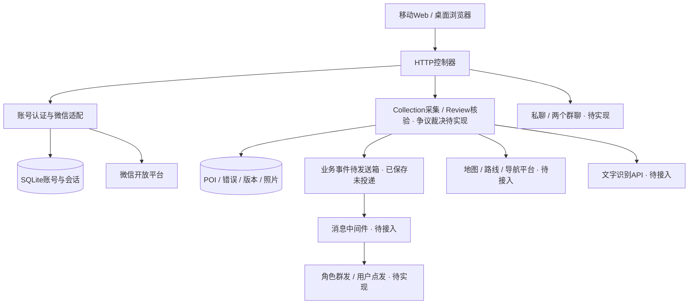

# check@collect目标架构

依据完整题目，采用移动浏览器与桌面浏览器共用的B/S结构，服务器按界面接入、业务、数据访问分层。11/5已实现认证、采集及核验处理；图中其余模块仍为目标。

| 构件职责（表1） | 当前/目标实现 | 边界 |
|---|---|---|
| Web表现和控制 | server、capture.js及核验页面已实现 | 接收操作、显示结果，不在浏览器保存应用密钥 |
| 认证与外部适配 | WeChat、Store已实现 | OAuth身份核验、账号关联、会话，不承担采集核验权限授权 |
| POI与争议服务 | Collection、Review已实现；第三方处理待开发 | 采集版本、错误标识、更新/重采/驳回，禁止越权和本人核验 |
| 通信与中间件 | event_outbox已保存；实际投递待11/6 | 角色广播、个人通知、私聊与群聊；消息中间件不等同数据库消息表 |
| 外部地图与OCR | 待接入 | 隔离供应商API与数据格式，保留真实调用证据 |

| 质量权衡（表2） | 设计做法 | 边界与验证 |
|---|---|---|
| 可修改性 | 平台适配与业务职责分开 | 微信、地图、OCR接入分别测试，不假定完全可替换 |
| 安全性 | 后端交换授权码、一次性状态、HttpOnly会话、角色和所有权检查 | 当前仅本地测试；公网需HTTPS与代理限流，核验角色由可信本机维护者授予 |
| 可靠性 | 错误/状态/通知事件同事务，版本检查防重复修改，照片历史保留 | 回滚和并发测试通过；中间件投递、断电和离线恢复待验收 |
| 移动适用性 | 响应式Web、设备定位与相机前端 | 定位需HTTPS/用户授权，真机照片与位置关联必须实测 |

认证采用HTTP控制器→认证/微信适配→仓储三部分，见[认证时序](diagrams/wechat-auth.puml)。SQLite与Python内置HTTP服务器用于当前课程本地开发，公网须部署HTTPS反向代理并验证；不把本地启动算作Internet部署。

课件依据：SADP04_n层风格PDF第22、26、37页（逻辑/物理分层与五层分组）；SADP04_软件体系结构风格第88—91页（B/S）；SADP05_UML第33页（关系）及顺序图内容。一图二表暂按总体结构图、构件职责表、质量权衡表组织；题干未指定两表的固定名称。提交前以适当UML部署/构件图替换上方设计草图并与实际代码核对。

## 11月4日实现进度

新增Collection，负责采集者角色、POI校验、SQLite记录及本机照片文件。HTTP控制器接收请求，采集脚本调用相机和定位API；地图核验、聊天、消息中间件、OCR仍为目标设计。照片经过Pillow解码并重新编码为JPEG，去除原图附带元数据，位置作为独立字段关联同一记录。

本地事务保证重复capture_id不重复建档，同一标识替换内容会被拒绝。文件落盘后才提交数据库，普通失败清理文件；突然断电仍可能留下未入库照片，尚无断电恢复验证。见[采集时序](diagrams/poi-capture.puml)。

## 11月5日实现进度

Review复用Collection的图片与位置校验，通过版本号和状态约束处理核验、更新、重采与驳回。核验角色只能由可信本机维护者授予，不能核验本人POI。错误和定向通知事件同事务保存；更新、重采保留历史快照与照片，驳回停在异议状态，后续接入讨论和第三方处理。见[核验时序](diagrams/poi-review.puml)。
