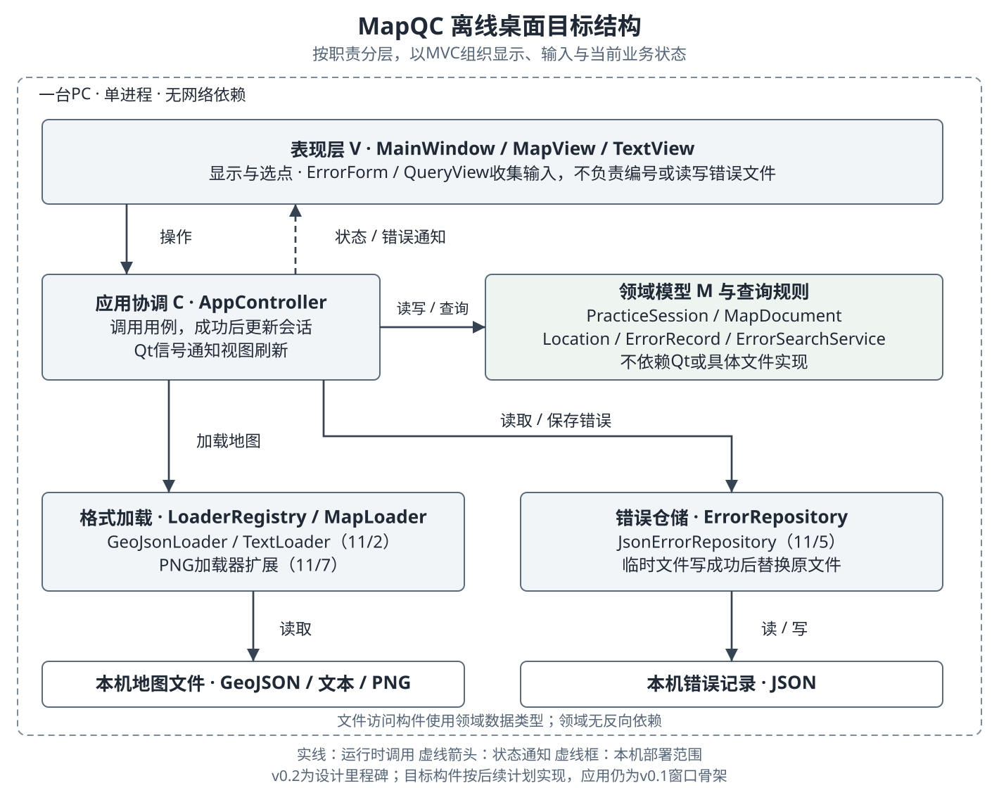

# 离线桌面架构设计

原计划日期：2026-11-01；实际设计与复核日期：2026-11-02。本文先记录晨间目标结构，当时程序为v0.1.0窗口骨架；晚间已实现的部分见文末进度。

## 风格选择

工具在一台PC上离线使用，主要操作是打开地图、选择位置、登记、保存和查询错误。比较以下方案后，选用单进程分层结构配合MVC。

| 方案 | 适合之处 | 本题中的代价 | 选择 |
| --- | --- | --- | --- |
| 窗口内集中处理业务和文件 | 起步快，调用直接 | 换格式或改界面都容易牵连编号、保存和查询，也难以脱离窗口测试 | 不采用 |
| 单进程分层与MVC | 满足离线条件，分开交互、业务状态和文件访问，便于逐项验证 | 增加接口和状态协调；分层本身不能解决大文件卡顿 | 采用 |
| C/S或B/S网络结构 | 适合集中数据与多用户访问 | 当前没有这些需求，会增加服务器、认证和部署依赖 | 留作扩展设计 |

逻辑分层不要求分开部署。以下构件都在同一进程中，地图和错误文件保存在本机。

## 构件职责

| 职责 | 目标构件 | 负责的工作与边界 | 实现计划 |
| --- | --- | --- | --- |
| 视图 V | MainWindow、MapView、TextView、ErrorForm、QueryView | 显示、选点和表单；将操作交给控制器，不读写错误文件或分配编号 | 11/3—11/6 |
| 控制 C | AppController | 协调加载、登记、保存与查询；成功后更新当前会话，发信号刷新视图 | 11/3起 |
| 模型 M | MapDocument、Location、ErrorRecord、PracticeSession | 表示地图、位置和错误；会话持有当前地图与记录，登记规则随后加入；不依赖Qt和文件实现 | 基础类型11/2；会话11/3起 |
| 查询规则 | ErrorSearchService | 对当前地图记录匹配编号、类型和描述中的关键字，不访问窗口 | 11/6 |
| 格式加载 | MapLoader、LoaderRegistry、GeoJsonLoader、TextLoader | 按接口选择格式，解析为MapDocument；坏输入报错，不修改当前会话 | 11/2；PNG扩展11/7 |
| 错误仓储 | ErrorRepository、JsonErrorRepository | 读写JSON；保存先写同目录临时文件，成功后替换原文件 | 11/5 |
| 组装入口 | app.main | 创建窗口、控制器及其依赖；当前只有最小窗口，后续在此连接构件 | 已有骨架；11/3组装 |

依赖关系按职责限定：视图把命令交给控制器；控制器调用领域逻辑、加载器和仓储；文件访问构件使用领域数据类型。领域对象不反向导入Qt或具体文件实现。这是允许控制器协调多个下层构件的分层方式，不规定每次只能调用图中相邻的一层。

MVC中的模型是会话及领域数据，控制器将状态变化转成Qt信号供视图刷新。窗口只保留绘制和交互所需状态。一次失败的加载不能先清空旧地图；只有解析和校验成功后，控制器才替换当前会话。

## 关键接口约定

以下为设计签名，不是已实现的API。字段和异常类型随对应日期的代码核对。

| 调用方 → 提供方 | 设计接口 | 约束 |
| --- | --- | --- |
| 视图 → AppController | open_map(path)、mark_error(location, type, description)、save_errors(path)、open_errors(path)、search_errors(keyword) | 窗口像素先转换为地图坐标；文本位置使用行号；空类型和描述由登记规则拦截 |
| AppController → LoaderRegistry | load(path: Path) → MapDocument | 注册表选择并调用加载器，返回统一文档；失败报错，不修改会话 |
| LoaderRegistry → MapLoader | can_load(path) → bool；load(path) → MapDocument | 具体加载器判断格式并解析；失败抛出可解释的异常 |
| AppController → PracticeSession | 切换文档、登记错误、取得当前记录 | 换地图清除旧记录与查询结果；编号从当前已验证的记录续接，不因重开而重用已有编号 |
| AppController → ErrorRepository | load(path) → list[ErrorRecord]；save(path, records) → None | 每条记录携带document_key；核对所属地图后再替换当前记录；保存成功才更新“已保存”状态 |
| AppController → ErrorSearchService | search(records, keyword) → list[ErrorRecord] | 输入限定为当前地图的记录；空关键字显示全部，空结果返回空列表 |
| AppController → 视图 | document_changed、records_changed、error_occurred | 传递显示所需的数据或错误信息；视图不接管持久化和编号规则 |

Location区分矢量坐标、栅格行列和文本行号。加载、登记、保存和查询共用这一位置表示，避免显示坐标与保存位置混用。

MapDocument与ErrorRecord均携带document_key，本轮由地图文件的规范化绝对路径确定。JSON保存每条记录的该字段，缺失时报告格式错误；控制器将读出记录的标识逐条与当前文档比对，全部匹配才替换会话。文件移动或重命名后的关联迁移不在本轮自动处理范围内。

## 质量权衡

| 质量关注点 | 设计做法 | 代价或边界 | 后续验证 |
| --- | --- | --- | --- |
| 可修改性与复用 | 用MapLoader接口隔离格式解析，登记、仓储和查询接收统一数据 | 新类型仍可能要扩充文档字段和视图；不能保证只改一个加载类 | 11/7记录PNG扩展的实际改动 |
| 可靠性与恢复 | 解析后再换会话；JSON用临时文件替换，异常由控制器提示 | 不支持多人写同一文件；临时文件方案不等于断电后绝不丢失 | 11/2坏文件；11/5往返与保存失败检查 |
| 可测试性 | 领域对象、解析与查询不依赖窗口 | 仍需单独验证Qt交互与坐标换算 | 11/2核心测试；11/3起交互验证 |
| 性能效率 | 本机单进程，无网络往返；先覆盖小型课程样例 | 大文件同步加载可能阻塞界面，分层不自动改善耗时 | 11/8记录机器、样例规模和实测耗时 |
| 可移植性 | 领域数据不用Qt控件，文件路径交给Path处理 | Qt平台依赖和打包需逐平台核对；现阶段只验证Windows骨架 | 11/8核对依赖；11/9验证实际运行包 |

界面替换时可保留领域规则、纯解析及查询逻辑；Qt控制器中的信号和显示协调需要适配。若以后改用数据库，可保留仓储职责，但本地路径、错误所属地图及并发编号策略仍要重新设计。这里不实现网络版本。

依据：SADP04 MVC风格PDF第3、5、15—16页；n层风格第3、6、22、26页；SADP02软件质量第46、71页。报告模板第2部分要求风格选择和优缺点分析，结构图、构件职责表及质量权衡表在此累计。

## 11月2日实现进度

MapDocument、Location、ErrorRecord以及MapLoader、LoaderRegistry、GeoJsonLoader、TextLoader已实现，见[核心类图](diagrams/core-classes.svg)。加载失败抛出LoadError，尚未接入控制器。上文其余接口仍为目标设计，原有v0.1运行包未更新。
