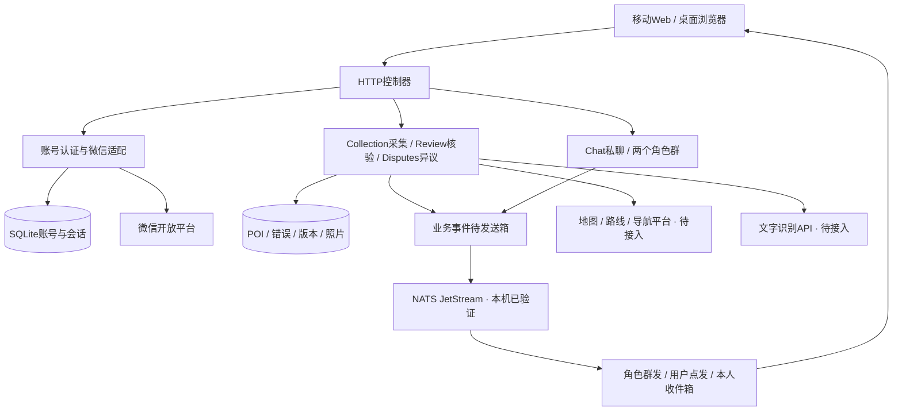

# check@collect目标架构

依据完整题目，采用移动浏览器与桌面浏览器共用的B/S结构，服务器按界面接入、业务、数据访问分层。11/7已实现认证、采集、核验、讨论与异议处理及系统通知；地图和OCR留11/8。

| 构件职责（表1） | 当前/目标实现 | 边界 |
|---|---|---|
| Web表现和控制 | server、capture.js及核验页面已实现 | 接收操作、显示结果，不在浏览器保存应用密钥 |
| 认证与外部适配 | WeChat、Store已实现 | OAuth身份核验、账号关联、会话，不承担采集核验权限授权 |
| POI与争议服务 | Collection、Review、Disputes | 版本、核验与重采、独立第三方指派和最终结论；按参与关系限制访问 |
| 通信与中间件 | Chat、NATS消息适配、event_outbox与收件箱 | 两个角色群和问题私聊；SQLite保存业务数据，NATS承担实际通知传输 |
| 外部地图与OCR | 待接入 | 隔离供应商API与数据格式，保留真实调用证据 |

| 质量权衡（表2） | 设计做法 | 边界与验证 |
|---|---|---|
| 可修改性 | 平台适配与业务职责分开 | 微信、地图、OCR接入分别测试，不假定完全可替换 |
| 安全性 | 后端交换授权码、一次性状态、HttpOnly会话、角色和所有权检查 | 当前仅本地测试；公网需HTTPS与代理限流，核验角色由可信本机维护者授予 |
| 可靠性 | 业务事件同事务、JetStream确认、收件入库后确认、事件ID去重 | 回滚、并发、真实投递和代理进程重启通过；断电、集群和公网仍待验收 |
| 移动适用性 | 响应式Web、设备定位与相机前端 | 定位需HTTPS/用户授权，真机照片与位置关联必须实测 |

认证采用HTTP控制器→认证/微信适配→仓储三部分，见[认证时序](diagrams/wechat-auth.puml)。SQLite与Python内置HTTP服务器用于当前课程本地开发，公网须部署HTTPS反向代理并验证；不把本地启动算作Internet部署。

课件依据：SADP04_n层风格PDF第22、26、37页（逻辑/物理分层与五层分组）；SADP04_软件体系结构风格第88—91页（B/S）；SADP05_UML第33页（关系）及顺序图内容。一图二表暂按总体结构图、构件职责表、质量权衡表组织；题干未指定两表的固定名称。提交前以适当UML部署/构件图替换上方设计草图并与实际代码核对。

## 11月4日实现进度

新增Collection，负责采集者角色、POI校验、SQLite记录及本机照片文件。HTTP控制器接收请求，采集脚本调用相机和定位API；地图核验、聊天、消息中间件、OCR仍为目标设计。照片经过Pillow解码并重新编码为JPEG，去除原图附带元数据，位置作为独立字段关联同一记录。

本地事务保证重复capture_id不重复建档，同一标识替换内容会被拒绝。文件落盘后才提交数据库，普通失败清理文件；突然断电仍可能留下未入库照片，尚无断电恢复验证。见[采集时序](diagrams/poi-capture.puml)。

## 11月5日实现进度

Review复用Collection的图片与位置校验，通过版本号和状态约束处理核验、更新、重采与驳回。核验角色只能由可信本机维护者授予，不能核验本人POI。错误和定向通知事件同事务保存；更新、重采保留历史快照与照片，驳回停在异议状态，后续接入讨论和第三方处理。见[核验时序](diagrams/poi-review.puml)。

## 11月6日实现进度

事件写入与业务共用事务，NATS适配独立处理发布与消费确认。角色群发在创建事件时确定接收者，本人通知接口按登录用户过滤。发布去重有时间窗，收件箱还以事件ID约束重复消费；送达、已读分别记录。仅本机NATS及进程恢复完成验证，公网与高可用尚未验证。见[消息时序](diagrams/notifications.puml)。

## 11月7日实现进度

Chat按当前角色控制群聊，私聊参与者从原错误记录确定。Disputes排除双方账号后指派第三方，重采数据经Collection校验，终裁、快照与双方通知在同一事务保存。照片历史记录实际采集账号，重复请求不重复发消息或裁决。现场重采列入演示验收；结构调用见[讨论与异议时序](diagrams/collaboration.puml)。
