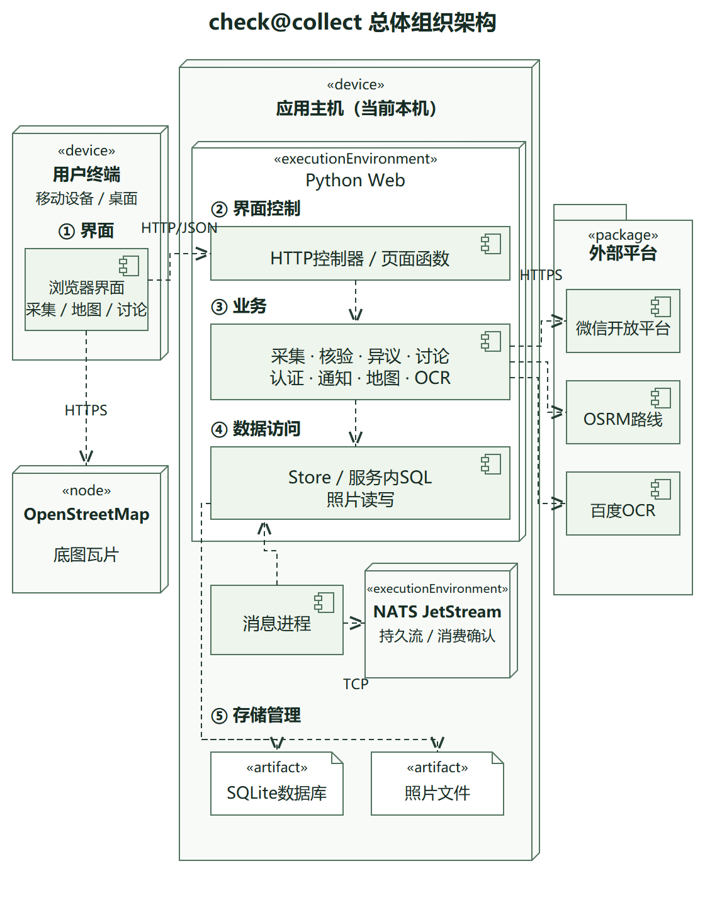

# check@collect架构设计

系统采用B/S与N层结构。浏览器负责拍照、定位、地图和交互，HTTP控制器转交请求，业务服务处理采集核验、讨论裁决、认证和平台调用。

图中虚线表示软件依赖，节点包含关系表示部署位置。界面、界面控制、业务、数据访问、存储管理五类职责中，浏览器界面位于终端，其余集中在应用主机。数据访问由Store、服务内SQL和照片读写实现，NATS为同机独立进程。

## 表1 解决方案映射表

| 关键需求 | 解决方案 | 对应构件或实现 |
|---|---|---|
| 照片、位置、类别与描述采集 | B/S入口、设备相机定位、服务端字段校验 | capture.js、HTTP控制器、Collection |
| 标错、更新、重采与驳回 | 业务服务分工、事务保存、版本约束 | Review、Collection、SQLite |
| 私聊、角色群与第三方裁决 | 按参与关系授权、独立第三方重采终裁 | Chat、Disputes |
| 群发与点发通知 | 业务事件同事务保存，NATS投递及去重 | events、Messaging、Notifications |
| 地图查询、导航与文字识别 | WGS84坐标、地图与平台适配器 | Leaflet、Maps、OsrmRouter、Ocr/BaiduOcr |
| 微信登录与账号绑定 | OAuth授权回调、一次性状态、会话校验 | WeChat、Store |

Collection.get_owned返回本人POI的编号与当前状态；Notifications.list_owned返回通知数据，notification_pages.page负责显示。微信、路线与OCR分别由WeChat、OsrmRouter和BaiduOcr适配器接入，平台凭据保存在后端环境变量。

## 表2 质量属性表

| 质量属性 | 设计措施与收益 | 代价或限制 |
|---|---|---|
| 功能适用性 | 采集、标错、更新、重采、讨论和终裁串成流程，保存照片历史 | 平台功能依赖应用凭据和网络，现场核验需要实际人员操作 |
| 可靠性 | 业务与通知事件同事务保存，NATS确认、重试和事件去重 | 单机存在单点；照片文件与数据库分开保存，进程重启测试不覆盖断电恢复 |
| 性能效率 | OCR按版本缓存，外部调用设超时，网络等待期间释放数据库事务 | 平台调用有网络等待；逐条权限查询带来开销，并发容量未测 |
| 操控性 | 浏览器显示错误和进展，重采自动定位，OCR提供分类建议 | 设备拒绝相机或定位权限时无法采集 |
| 安全性 | 会话、角色和所有权检查，OAuth状态一次使用，照片外发前确认 | 公网入口需代理限流及运维配置 |
| 兼容性 | HTTP/JSON连接浏览器，使用WGS84，外部协议分别适配 | 浏览器权限策略或平台接口变化可能需要调整适配代码 |
| 可维护性 | 通知数据与页面分离，平台接口可替换，采集校验复用 | SQL分布于服务内，更换数据库仍涉及多个模块 |
| 移植性 | 浏览器减少终端安装，后端使用Python和可配置路径 | 热点启动脚本面向Windows，Linux部署未测试 |

手机已通过热点HTTPS上传照片和自动位置，通知经NATS送达。软件流程有本地HTTP及消息测试，OSRM有真实路线响应。百度OCR与微信接口代码已完成，应用凭据尚未配置，真实授权尚未联调。公网访问、现场到达导航和第三方现场重采未作实地演示。

## 课件对应

- 《SADP04_n层风格》第22、26、37页：职责分层、逻辑与物理部署、五层分组。
- 《SADP04_软件体系结构风格》第88—91页：B/S。
- 《SADP05_UML》第45、48—51页：构件、接口、依赖与部署。
- 《SADP02_软件质量》第46页：表2的八项特性及排列顺序。

图源为[PlantUML](diagrams/system-components.puml)与[SVG](diagrams/system-components.svg)。交互图见[采集](diagrams/poi-capture.puml)、[核验](diagrams/poi-review.puml)、[通知](diagrams/notifications.puml)、[讨论裁决](diagrams/collaboration.puml)和[地图OCR](diagrams/map-ocr.puml)。
