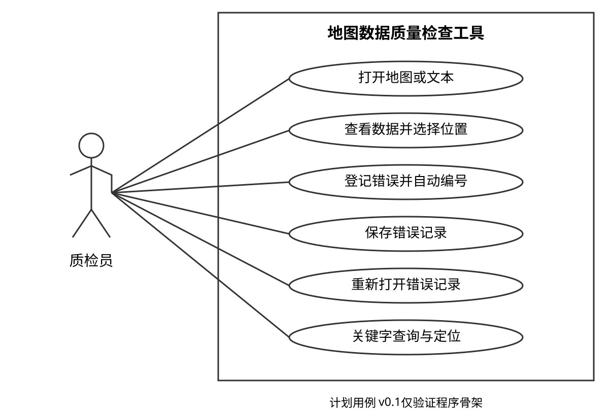

# 综合实践报告正文草稿

## 1 功能需求及环境限制

MapQC用于人工检查地图数据。质检员打开图形或文本，在指定位置填写错误类型与描述，再保存或查询记录。工具在单台PC离线运行。基本功能先覆盖GeoJSON与文本，后续用PNG扩展检验格式加载的可修改性。

本轮先验证Windows下的运行与打包，其他平台的适配范围另行说明。v0.1只完成项目骨架，功能实现按逐日计划继续。

## 2 体系结构与质量分析

11/1形成结构图、构件职责表和质量权衡表，之后随代码核对。

## 3 开发实现与部署

验证证据随日记录在`evidence`；开发与部署图在相关版本形成。

## 4 团队分工

成员姓名、实际分工和比例待核实。
